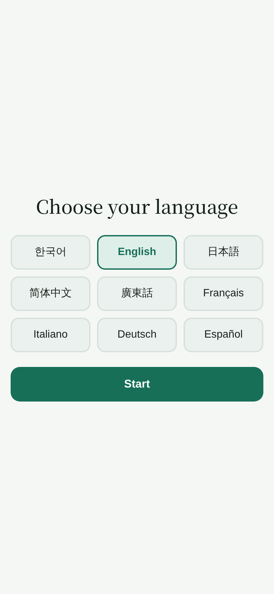
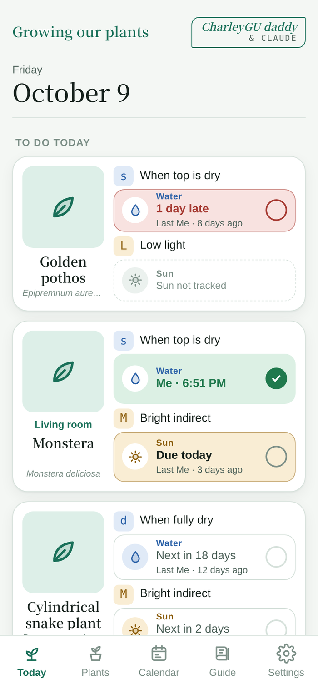
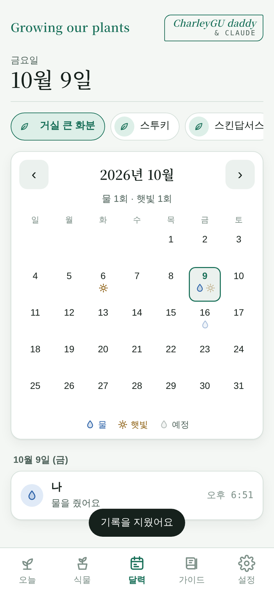

# Growing our plants

*[한국어](README.md) · English*

An Android app that reminds you **when to water and when to give sun** to your houseplants, and records it with one tap.
Free, no ads. *CharleyGU daddy & Claude*

## ⬇️ Download

### **[👉 Tap here for the latest APK](https://github.com/amons-tech/growing-our-plants/releases/latest)**

Open **Assets** under the top release and tap `growing-our-plants-*.apk`.
It is easiest to open this page in Chrome on your phone and download it there.

Point your phone camera at this code to go to the same place. (For printing: [docs/qr-print.png](docs/qr-print.png))

---

|  |  |  |
|---|---|---|
|  |  |  |
| Pick a language once | Water, sun and Green MBTI per plant | A month per plant |

## What it does

- Comes with a **care table for 209 common plants**. In **Add a plant**, take a photo and pick from **Plants I know · LIST**; watering, light, temperature and humidity are filled in. Not in the list? Just type the name.
- Every plant gets a four-letter **Green MBTI**: light · temperature · humidity · watering. Monstera is `M W N s`, sago palm `D F A d`. The **Guide** tab explains each letter.
- Use the **Green MBTI** button at the top of **Plants** to filter your plants. Pick several letters to see only the plants that match all of them.
- Tap a plant, then its photo, to **change the photo** at any time.
- On **Today**, each plant has a water box and a sun box. **Tap anywhere on a box** to mark it done.
- Late is red, due today is blue or yellow, done is green.
- Above the water box you see the **watering code** (e.g. `s` when the top is dry); above the sun box the **light code** (e.g. `M` bright indirect). The **Guide** tab explains them.
- In **winter (Nov–Feb)** the watering interval gets longer automatically.
- **Shade plants** can have the sun check turned off.
- Growing the same plant in several pots? Tell them apart with a **nickname**.
- The **Calendar** tab shows a month of watering and sun per plant.
- You get a **reminder** at the times you set when something is due. It keeps working with the app closed and after a restart.

## 👨‍👩‍👧 Care together as a family

So Dad's phone doesn't nag about watering a plant Mom already watered, the whole family shares the same plants and records.

1. One person taps **Settings → Create a family** and enters what the family calls them (e.g. Mom). That phone's plants and records become the family's, and a **6-character invite code** appears.
2. Tap **Send code** to share it by message.
3. Everyone else opens **Settings → Join with a code** on their phone and enters the code and their name.

- When someone checks water or sun, the other phones update **automatically** (within 30 seconds while the app is open). Tap **Sync** at the top right to fetch right away.
- Just before a reminder rings, the phone checks the family's records, so **tasks someone already did are left out**. For this to work on time, *Not battery-optimized* must show ✓.
- Each record shows who did it. Anyone in the family can add, edit or delete plants.
- **Leave family** keeps the family's records, and that phone goes back to the records it had before joining.
- Checks made while offline are not saved; tap again once you're connected.

## Nine languages

한국어 · English · 日本語 · 简体中文 · 廣東話 · Français · Italiano · Deutsch · Español

It follows your phone language on first launch, and you can change it any time in Settings. Notifications use the same language.

## How to install

1. Download `growing-our-plants-*.apk` from **Download** above.
2. Tap the downloaded file.
3. If you see an **“unknown sources”** warning → *Settings* → *Allow from this source* → tap the file again.
   (This is normal for apps installed outside the Play Store.)
4. A **Growing our plants** icon appears on your home screen.

When a new version comes out, download it from the same place and **install it over the old one**. Your records stay.

## One-time setup

In **Settings → So reminders arrive on time**, make sure all three show **✓**.

| Item | Why |
|---|---|
| Notifications | Lets the app show reminders |
| Exact alarms | Rings at the time you set |
| Not battery-optimized | Stops power saving from blocking reminders |

Then add plants from **Plants → Add a plant** and set your water and sun reminder times in Settings.

## Privacy

- Without family sharing, records stay **only on this phone** and nothing is sent to the internet.
- **With family sharing**, plants (name, photo, schedule), water and sun records, and family names are stored on Google Firebase servers (Seoul). No email or phone number is asked for; each phone gets a nameless account automatically.
- Only family members who joined with the invite code can read or write those records.
- No ads.
- Plant photos are kept as small images inside the app. Photos taken with the camera also stay in your gallery's *GrowingOurPlants* folder.

## Good to know

- The care table gives **indoor averages**. Pots, soil and light differ, so adjust each plant with −/+.
- **AI plant identification** comes in the next version.
- If you uninstall and reinstall the app, the phone leaves the family. Join again with the invite code and the family's records are all there.

## Contact

Report problems or ideas in [Issues](https://github.com/amons-tech/growing-our-plants/issues).
