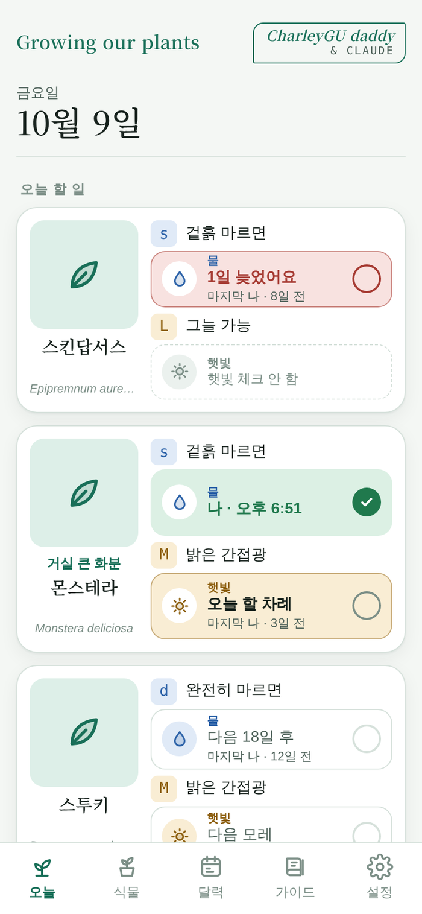
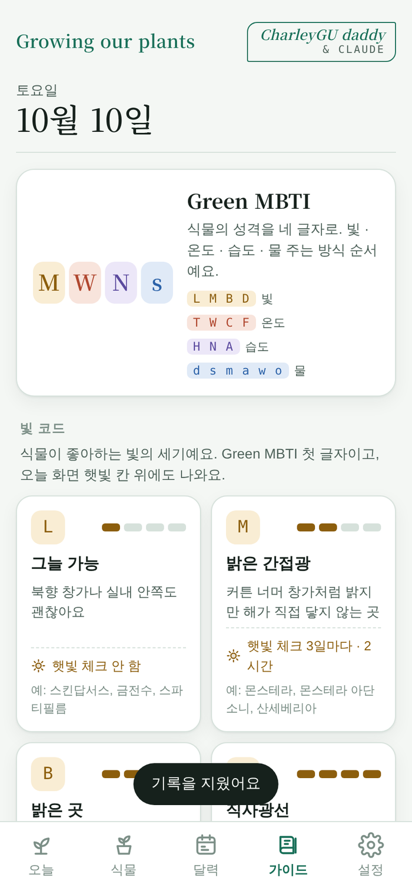

# Growing our plants

*한국어 · [English](README.en.md)*

집에서 키우는 반려식물의 **물 주기와 햇빛 보기**를 알려주고, 한 번 눌러 기록하는 안드로이드 앱입니다.
무료이고, 광고가 없습니다. *CharleyGU daddy & Claude*

## ⬇️ 내려받기

### **[👉 여기를 눌러 최신 APK 받기](https://github.com/amons-tech/growing-our-plants/releases/latest)**

맨 위 버전의 **Assets** 를 펼쳐 `growing-our-plants-*.apk` 를 누르면 내려받아집니다.
휴대폰의 크롬에서 이 쪽을 열어 바로 받으시면 가장 편합니다.

휴대폰 카메라를 이 무늬에 갖다 대면 같은 곳으로 갑니다. (인쇄용: [docs/qr-print.png](docs/qr-print.png))

---

|  |  |  |
|---|---|---|
|  |  |  |
| 처음 켤 때 언어를 한 번 | 식물마다 물·햇빛과 Green MBTI | 코드 뜻과 209종 주기표 |

## 어떤 앱인가요

- **식물 209종의 기본 주기표**가 들어 있습니다. **식물가족 추가**에서 사진을 찍고 `내가 아는 식물 LIST`에서 고르면 물 주기, 물 주는 방식, 빛, 온도, 습도가 자동으로 채워집니다. 목록에 없으면 이름을 직접 적으면 됩니다.
- 식물마다 **Green MBTI** 네 글자가 붙습니다. 빛 · 온도 · 습도 · 물 주는 방식 순서예요. 예: 몬스테라 `M W N s`, 소철 `D F A d`. 뜻은 **가이드** 탭에 있습니다.
- **식물** 탭 위의 **Green MBTI** 단추로 내 식물을 거를 수 있어요. 글자를 여러 개 고르면 모두 맞는 식물만 보입니다.
- 키우는 중에도 식물을 눌러 사진을 누르면 **사진을 바꿀 수** 있어요.
- **오늘** 화면에 식물마다 물 칸과 햇빛 칸이 있습니다. **칸 아무 데나 누르면** 완료로 바뀝니다.
- 늦은 일은 빨강, 오늘 할 일은 파랑·노랑, 끝난 일은 초록으로 보입니다.
- 물 칸 위에는 **물 주는 방식 코드**(예: `s` 겉흙 마르면), 햇빛 칸 위에는 **빛 코드**(예: `M` 밝은 간접광)가 나옵니다.
- **겨울(11~2월)** 에는 물 주기가 자동으로 길어집니다.
- **음지 식물**은 햇빛 체크를 끌 수 있습니다.
- 같은 식물을 여러 화분에 키우면 **별칭**(예: 거실 큰 화분)으로 구분합니다.
- **달력** 탭에서 식물별로 한 달 동안 물·햇빛 기록을 봅니다.
- 정해진 시각에 할 일이 있으면 **알림**이 옵니다. 앱을 닫아도, 휴대폰을 껐다 켜도 알림이 되살아납니다.

## 👨‍👩‍👧 가족과 함께 돌보기

엄마가 물을 줬는데 아빠 폰에서 또 물 주라고 울리는 일이 없도록, 가족이 같은 식물과 기록을 함께 봅니다.

1. 한 사람이 **설정 → 가족 만들기** 를 누르고 부르는 이름(예: 엄마)을 넣습니다. 그 폰의 식물과 기록이 가족 것이 되고, **6자리 초대코드**가 생깁니다.
2. **코드 보내기** 로 카톡·문자에 코드를 보냅니다.
3. 가족은 각자 폰에서 **설정 → 초대코드로 들어가기** 에 코드와 부르는 이름을 넣습니다.

- 누가 물·햇빛을 체크하면 다른 폰에도 **자동으로** 반영됩니다(앱을 켜 두면 30초 안에). 오른쪽 위 **동기화** 를 누르면 바로 받아옵니다.
- 알림이 울리기 직전에 가족 기록을 확인해서, **이미 다른 가족이 한 일은 알림에서 빠집니다.** 이게 제때 되려면 *배터리 최적화 제외* 가 ✓ 여야 합니다.
- 기록마다 누가 했는지 부르는 이름이 보이고, 식물 추가·수정·삭제는 가족 누구나 할 수 있습니다.
- **가족에서 나가기** 를 하면 가족 기록은 그대로 남고, 그 폰은 가족에 들어오기 전 기록으로 돌아갑니다.
- 인터넷이 끊긴 동안에는 체크가 저장되지 않으니, 연결된 뒤 다시 눌러 주세요.

## 아홉 언어

한국어 · English · 日本語 · 简体中文 · 廣東話 · Français · Italiano · Deutsch · Español

처음 켤 때 휴대폰 언어를 따라가고, 설정에서 언제든 바꿉니다. 알림 문구까지 그 언어로 나옵니다.

## 설치하는 법

1. 위 **내려받기** 에서 `growing-our-plants-*.apk` 를 받습니다.
2. 내려받은 파일을 누릅니다.
3. **“출처를 알 수 없는 앱”** 경고가 나오면 → *설정* → *이 출처 허용* → 다시 누르면 설치됩니다.
   (플레이스토어를 거치지 않는 앱이라 나오는 정상 경고입니다.)
4. 홈 화면에 **Growing our plants** 아이콘이 생깁니다.

새 버전이 나오면 같은 곳에서 받아 **그 위에 그냥 설치**하시면 됩니다. 지난 기록은 그대로 남습니다.

## 처음 한 번 해줄 설정

앱 → **설정** 의 *알림이 제때 오도록* 에서 세 가지가 모두 **✓** 인지 확인해 주세요.

| 항목 | 하는 일 |
|---|---|
| 알림 표시 권한 | 알림을 화면에 띄울 수 있게 합니다 |
| 정확한 시간 알람 | 정한 시각에 맞춰 울리게 합니다 |
| 배터리 최적화 제외 | 절전 기능이 알림을 막지 않게 합니다 |

그다음 **식물** 탭 → **식물가족 추가** 로 식물을 등록하고, 설정에서 물·햇빛 알림 시각을 정하면 끝입니다.

## 개인정보

- 가족 공유를 쓰지 않으면 기록은 **이 휴대폰 안에만** 저장되고, 인터넷에 아무것도 보내지 않습니다.
- **가족 공유를 쓰면** 식물(이름·사진·주기), 물·햇빛 기록, 부르는 이름이 Google Firebase 서버(서울)에 저장됩니다. 이메일·전화번호 같은 로그인 정보는 받지 않고, 폰마다 이름 없는 계정이 자동으로 하나 생깁니다.
- 서버의 기록은 **초대코드로 들어온 가족만** 읽고 쓸 수 있습니다.
- 광고는 없습니다.
- 식물 사진은 작은 그림으로 앱 안에 저장됩니다. 카메라로 찍은 원본은 사진첩의 *GrowingOurPlants* 폴더에도 남습니다.

## 알아두실 점

- 주기표의 숫자는 **실내 평균 기준값**입니다. 화분 크기, 흙, 볕에 따라 다르니 식물마다 −/+ 로 맞춰 주세요.
- **AI 식물 검색**은 다음 버전에서 열립니다.
- 앱을 지웠다 다시 설치하면 가족 연결이 끊깁니다. 초대코드로 다시 들어오면 가족 기록이 그대로 보입니다.

## 문의

문제가 있거나 고쳤으면 하는 점은 [Issues](https://github.com/amons-tech/growing-our-plants/issues) 에 남겨 주세요.
